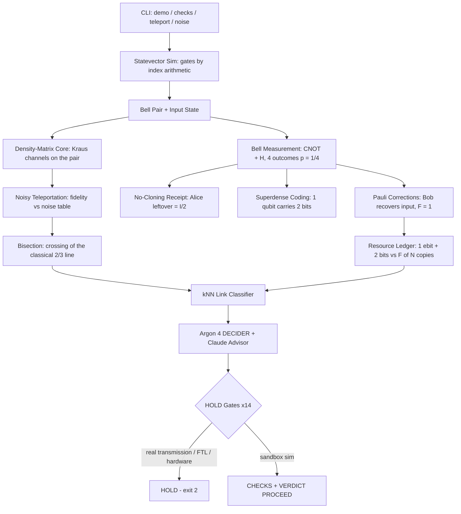
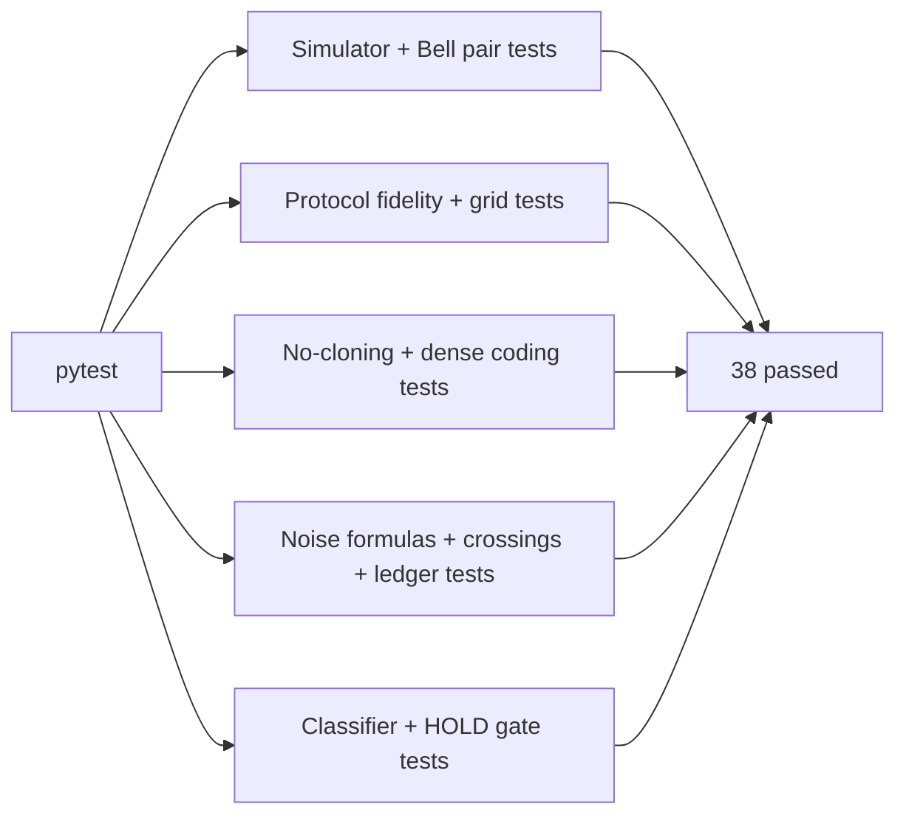
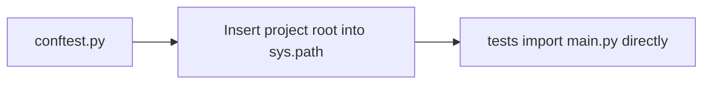
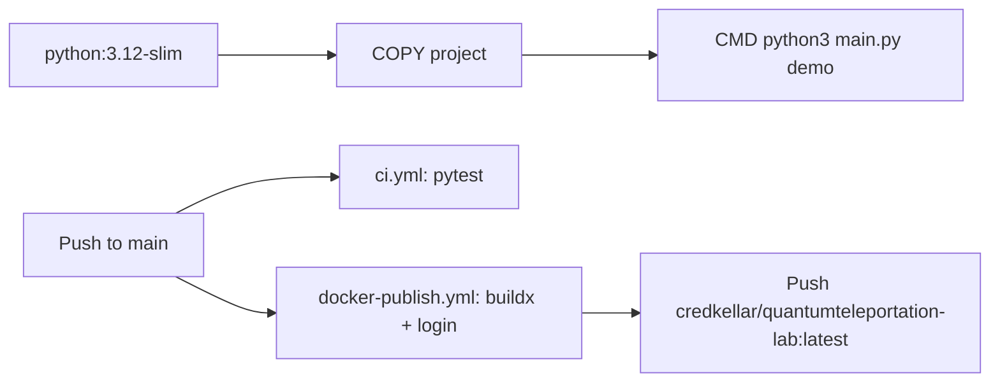

# QuantumTeleportation-Lab ⚛️📡

**Quantum Teleportation Protocol Lab** — by Darion Kellar

QuantumTeleportation-Lab is an **educational quantum teleportation lab** in ONE pure-Python file. It runs the actual protocol end to end on a from-scratch 3-qubit statevector simulator — an arbitrary labelled qubit state, one shared Bell pair, a Bell-basis measurement, **2 classical bits**, and Pauli corrections — and then it does the part most explainers skip: it **proves the original is destroyed** (the sender's qubit is left in exactly the maximally mixed state I/2), prices the protocol against the best classical strategy, and degrades the shared pair with labelled noise channels to find the exact noise level where the quantum protocol **stops beating** the classical 2/3 line. 🔬

Honest scope, stated up front: **nothing was teleported anywhere.** There is no photon, no fibre, no network, and no second location — "Alice" and "Bob" are registers inside one Python process, and the "channel" in the noisy section is a Kraus map applied to a matrix. Teleportation here moves a *state description* using pre-shared entanglement plus classical bits; it cannot clone (the original is destroyed — the lab shows the receipt) and it cannot signal faster than light (Bob's qubit is I/2 until the classical bits arrive — the lab shows that too). Every real-communication / quantum-internet / hardware claim sits behind a permanent HOLD gate (14 total). 🔒

[](https://github.com/kimanicollier44-cmyk/QuantumTeleportation-Lab/actions/workflows/ci.yml)
[](https://github.com/kimanicollier44-cmyk/QuantumTeleportation-Lab/actions/workflows/docker-publish.yml)

> ℹ️ These are the **live** workflow badges for this repo. They activate as soon as the `ci.yml` and `docker-publish.yml` files from the paste pack are pasted into `.github/workflows/` — until then they have nothing to report yet.

## 🧰 Tech Stack Badges & Full Architecture Tech Stack

### 💻 Core Programming Languages & Core Systems


- 🐍 Python 3.12, pure standard library (`math`, `hashlib`, `json`, `sys`) — zero dependencies, zero network, deterministic (double-run byte-identical)
- ⚛️ Statevector core from scratch: H / X / Y / Z gates and CNOT applied by index arithmetic on 8 complex amplitudes — the Bell pair, the Bell-basis rotation (CNOT + H), all four measurement outcomes, and the Pauli corrections are computed, never quoted
- 🔬 Density-matrix noise core from scratch: 8×8 density matrices, Kronecker products, partial traces, and Kraus channels written operator by operator (depolarizing: √(1−p)·I + √(p/3)·{X, Y, Z}; dephasing: √(1−q)·I + √(q)·Z) — every simulated fidelity is graded against its closed form in CHECKS
- 📒 Resource ledger: the quantum cost (1 ebit + 2 classical bits + 1 copy → fidelity exactly 1) printed against the optimal classical estimation fidelity F(N) = (N + 1)/(N + 2) — the 2/3 bound is its N = 1 case, and 0.99 costs N = 98 copies
- 🧠 TinyML kNN link classifier (from scratch, stdlib, distance-weighted): perfect-protocol / beats-classical / classical-tie / broken from channel + noise strength + delivered fidelity, labels from the lab's own policy
- 🪑 Council seats: Gemini Argon 4 DECIDER (names-only, tighten-only) + Muse advisor (never overrides HOLD) + Google Flow plan-only (rendered = False, live = 0)

### ⛓️ Web3 & Infrastructure

- 🚫 **Not applicable — honestly.** No blockchain, no Web3, no tokens: the "infrastructure" in this lab is one offline file holding three simulated qubits. Quantum-internet deployment is a permanent HOLD gate, not a feature. No fake badges here.

### ⚙️ Platform Support & Hardware Architecture


- 🖥️ Pure Python — runs anywhere Python 3.12+ runs (Linux, macOS, Windows), plus the `python:3.12-slim` Docker image
- 🔒 No hardware is controlled, ever: real photonic links, ion traps, superconducting qubits, and network nodes are permanent HOLD gates (see the gate table below)

### ⚡ Low-Level Infrastructure & Performance

- 🚫 **No low-level code — honestly.** No C, no C++, no GPU, no compiled extensions: this is one interpreted Python file on purpose, so every amplitude can be read, checked, and diffed. Performance here means honest algorithms — an 8-amplitude statevector, exact 8×8 density-matrix algebra, and a 60-step bisection that locates the classical-bound crossing to 1e-6 — all deterministic and byte-identical between runs.

### 🛠️ DevOps & Build Tools


- 🐳 Docker (`python:3.12-slim`), GitHub Actions CI + Docker Publish (delivered in the paste pack)
- 🎯 Target image: `credkellar/quantumteleportation-lab:latest`
- 🧪 Tests: `pytest` (38 tests) + the built-in CHECKS suite (45 checks) in `main.py`

### ☁️ Cloud Providers

- 🚫 **None — honestly.** No cloud provider is used or needed: the lab runs fully offline on your own machine or in a local Docker container. Docker Hub appears only as the registry the publish workflow pushes the image to.

## What this does?

1. 🎯 **The protocol, end to end** — the headline input |ψ⟩ = 0.6|0⟩ + 0.8|1⟩ (exact labelled amplitudes, 0.36 + 0.64 = 1) meets a Bell pair; Alice's CNOT + H rotates her two qubits into the Bell basis, and all **four outcomes occur at p = 0.2500 each**. After the matching Pauli correction, Bob's qubit matches the input with **fidelity 1.000000000000 for every outcome** — computed from the amplitudes, not asserted from the textbook.
2. 🔁 **A grid of inputs, not one lucky state** — 8 labelled states (both poles, the equator at three phases, and three in between) are teleported through all four outcomes each: worst fidelity across the whole grid is **1.000000000000** and the worst probability error vs 1/4 is under 1e-12.
3. 💥 **The no-cloning receipt** — after the Bell measurement (outcomes summed over, the non-selective state), Alice's original qubit is traced out of the density matrix: it is **I/2 with max deviation 1.11e-16**, and its overlap with the input is exactly **0.5000** — the maximally mixed value. The same receipt holds for a different input state, because the leftover carries *no* information about the input. The original is destroyed, not copied.
4. 🤫 **The no-signalling receipt** — Bob's qubit, before the 2 classical bits arrive, is also **I/2 (deviation 1.11e-16)**: averaged over Alice's outcomes he holds pure noise. Nothing usable moves until the classical bits — which travel at most at light speed — arrive. Relativity survives; the lab shows the matrix.
5. ✉️ **Superdense coding — the pair does double duty** — Alice applies one of I, X, Z, XZ to her half of the same Bell pair and sends **one qubit**; Bob's Bell decode (CNOT + H) reads **2 classical bits**. All four messages (00, 01, 10, 11) decode with probability **1.0000**, and the four encoded states are verified mutually orthonormal — they are the four Bell states.
6. 📉 **Depolarizing noise, graded against its closed form** — Bob's half of the pair passes a Kraus depolarizing channel; the delivered fidelity falls **1.000 → 0.9333 → 0.8667 → 0.8000 → 0.7333 → 0.6667 → 0.6000 → 0.5333 → 0.4667 → 0.4000 → 0.3333** as p goes 0 → 1, matching the closed form F = 1 − 2p/3 to under 1e-9 at every graded point. At p = 0.75 the pair is fully depolarized and the fidelity is exactly **0.5000** — a coin flip.
7. 🌫️ **Dephasing noise, with its input dependence shown** — the dephasing channel mixes in a Z-flipped copy, so F = (1 − q) + q·(|α|² − |β|²)²: for the headline state the fidelity falls 1.000 → **0.0784** at q = 1 (the surviving Z-overlap), while an equatorial input falls as exactly 1 − q. The simulation matches both formulas — the channel punishes states differently and the lab prints why.
8. ⚖️ **The classical line, and where the quantum protocol crosses it** — the best classical measure-and-resend fidelity for a qubit is **2/3**. A 60-step bisection on the simulated fidelity finds where each channel crosses it: **depolarizing at p = 0.500000** (analytic 0.5) and **dephasing at q = 0.361690** (analytic 0.361690) — the noise budgets a real link would have to beat, computed two independent ways.
9. 📒 **The resource ledger** — teleportation spends **1 ebit + 2 classical bits + the input copy** and delivers fidelity exactly 1. The classical alternative is priced by the optimal estimation formula F(N) = (N + 1)/(N + 2): N = 1 gives the 2/3 bound, N = 10 gives 0.9167, fidelity 0.99 needs **N = 98 copies**, and no finite N ever reaches 1.
10. 🏷️ **Link classifier + seats + checks** — a from-scratch distance-weighted kNN labels links perfect-protocol / beats-classical / classical-tie / broken (ideal → perfect-protocol; depolarizing p = 0.25 → beats-classical; p = 0.50 → classical-tie; p = 0.90 → broken), with Argon 4 DECIDER (sha256 trace), Muse advisor, Google Flow plan-only, and a built-in CHECKS suite (45 checks).

## 🗺️ How it works — diagram per script

### `main.py` — the whole lab



### `tests/test_main.py` — verification



### `conftest.py` — test path setup



### `Dockerfile` + CI flow — container & publish



## Why is this cool?

1. 🎯 Teleportation is **run, not retold**: the fidelity-1 recovery falls out of 8 complex amplitudes and a CNOT, for all four outcomes — you can change the input state and watch it still work.
2. 💥 The no-cloning receipt is a **matrix, not a slogan**: Alice's leftover qubit is I/2 to 1.11e-16, with overlap exactly 1/2 against *any* input — the destruction of the original is measured.
3. 🤫 The no-signalling receipt is the same trick played on Bob: before the classical bits arrive he holds exactly I/2, so the "instant transfer" myth dies in one partial trace.
4. ✉️ The same Bell pair moonlights as a **2-for-1 classical channel**: superdense coding decodes all four messages at probability 1.0000, and the lab verifies the four encoded states really are the orthonormal Bell basis.
5. 📉 Noise is graded, not vibes: both Kraus channels are simulated on density matrices *and* matched to their closed forms to under 1e-9 — where they disagree, the checks fail.
6. ⚖️ The classical 2/3 bound is **derived in the lab** as the N = 1 case of the estimation formula, then used as the finish line the noisy protocol has to beat — and the crossing noise levels are bisected out of the simulation itself.
7. 🌫️ Dephasing teaches a subtle lesson with numbers: it leaves pole states completely untouched (they are Z eigenstates) and punishes equatorial states hardest, and the fidelity formula F = (1 − q) + q·(|α|² − |β|²)² shows that input dependence explicitly instead of hiding it in an average.
8. 📒 The ledger makes the quantum advantage countable: 1 ebit + 2 bits for exact transfer vs **98 copies** for a classical 0.99 — and infinity for a classical 1.
9. 🏷️ The classifier has to earn its labels: scenario fidelities come from the density-matrix simulator, and the distance-weighted kNN is checked against the lab's own policy on every scenario — including the knife-edge classical-tie at exactly F = 2/3.
10. 🎯 Deterministic end to end: run it twice, get byte-identical output — a teleportation you can diff.

## What problems this solves?

1. ❌ **Problem:** Teleportation is usually explained as "the state travels instantly," which is false. ✅ **Solution:** The ledger and the no-signalling receipt show the 2 classical bits doing the travelling while Bob's pre-bits state is exactly I/2.
2. ❌ **Problem:** "Teleportation clones the qubit" is a standard misconception. ✅ **Solution:** The sender's leftover is computed from the density matrix: I/2, overlap 1/2 with the input — destroyed, not copied.
3. ❌ **Problem:** Protocol demos use one convenient input state and declare victory. ✅ **Solution:** An 8-state grid × 4 outcomes is teleported and graded; the worst fidelity is the headline, not the best.
4. ❌ **Problem:** Noise sections in explainers say "noise reduces fidelity" without a number. ✅ **Solution:** Two full fidelity-vs-noise tables, each point matched to a closed form, with the fully-noisy anchors (0.5000 and 0.0784) explained.
5. ❌ **Problem:** The classical 2/3 bound is quoted like trivia. ✅ **Solution:** It is derived as the N = 1 case of F(N) = (N + 1)/(N + 2), and the quantum protocol's crossing points are located by bisection on the simulation.
6. ❌ **Problem:** Superdense coding is often taught as a separate magic trick. ✅ **Solution:** It is run on the same pair object as teleportation, with the orthonormality of the four Bell encodings asserted — one resource, two protocols.
7. ❌ **Problem:** "Quantum advantage" claims stay abstract. ✅ **Solution:** The advantage is a countable ledger: 1 ebit + 2 bits vs 98 classical copies for 0.99, and no finite copy count for 1.
8. ❌ **Problem:** Channel choice in toy demos is arbitrary and unexamined. ✅ **Solution:** Depolarizing and dephasing are both implemented from Kraus operators and compared — including dephasing's input-dependent damage, printed per state.
9. ❌ **Problem:** Simulation tools quietly imply a communication product is next. ✅ **Solution:** 14 named HOLD gates return exit code 2 for every transmission, network, service, or FTL claim, forever.
10. ❌ **Problem:** Verdict labels in classifier demos are hand-assigned. ✅ **Solution:** Labels come from the lab's own written policy applied to a formula-labelled grid, and the classifier is asserted to agree with that policy on simulator-computed scenarios.

## How to install this?

1. 📋 Clone or download this project folder.
2. 🐍 Make sure Python 3.12+ is installed: `python3 --version`
3. ▶️ Run the full demo + checks (no arguments needed):

```bash
python3 main.py
```

4. 🧪 Run the test suite:

```bash
pip install pytest
python3 -m pytest -q
```

5. 🎛️ Try the other commands:

```bash
python3 main.py checks    # 45 built-in checks
python3 main.py teleport  # ideal protocol report (JSON)
python3 main.py grid      # 8-state input grid report (JSON)
python3 main.py clone     # no-cloning receipt (JSON)
python3 main.py dense     # superdense coding report (JSON)
python3 main.py noise     # noisy-channel tables + 2/3 crossings (JSON)
python3 main.py ledger    # resource ledger (JSON)
python3 main.py classify  # kNN link classifier report
python3 main.py brains    # Argon 4 + Muse + Flow seats
python3 main.py holds     # list all 14 HOLD gates
python3 main.py hold-demo # exits 2 - gated actions stay HOLD
```

6. 🐳 Or run it in Docker:

```bash
docker build -t credkellar/quantumteleportation-lab:latest .
docker run --rm credkellar/quantumteleportation-lab:latest
```

## Requirements

- 🐍 Python 3.12 or newer
- 📦 Dependencies: **none** (standard library only)
- 🌐 Network: **none** — fully offline
- 🧪 For tests only: `pytest`
- 🐳 Optional: Docker

## FULL project structure tree

```text
quantumteleportation-lab/
├── main.py                  # the whole lab: statevector sim, teleportation, no-cloning receipt, dense coding, Kraus noise, crossings, ledger, classifier, seats, HOLD gates
├── conftest.py              # puts the project root on sys.path for tests
├── tests/
│   └── test_main.py         # 38 pytest tests: simulator, protocol, receipt, dense coding, noise, ledger, classifier, gates
├── assets/
│   └── cover.png            # README cover image (2736 x 912)
├── Dockerfile               # python:3.12-slim, runs the demo
├── .gitignore               # __pycache__/, .pytest_cache/, *.pyc
└── README.md                # this file
```

> 📦 Delivered separately as paste packs (not in this tree): `.github/workflows/ci.yml` + `docker-publish.yml`, and the Docker Hub pack (100-char description, 350-char About, overview, categories).

## 🔒 HOLD gates — all 14, permanent

| # | Gate | What stays held |
|---|------|-----------------|
| 1 | `real_message_transmission` | No real message or quantum state was transmitted anywhere; Alice and Bob are registers in one process |
| 2 | `quantum_internet_service_claim` | No quantum internet service; there is no network in this lab |
| 3 | `faster_than_light_claim` | Teleportation needs 2 classical bits that travel at most at light speed; no FTL claim, ever |
| 4 | `real_hardware_control` | No control of real photonic, ion-trap, superconducting, or any other quantum hardware |
| 5 | `photonic_network_operation` | No operating photonic links, repeaters, or network nodes |
| 6 | `qkd_service_claim` | No QKD service or key-distribution claim; teleportation is not a product |
| 7 | `production_communication_use` | No production communication system may be built on a teaching simulator |
| 8 | `vendor_benchmark_claim` | No vendor or hardware benchmark claims from a laptop statevector |
| 9 | `state_cloning_claim` | No cloning: the protocol destroys the original, and this lab proves that instead of hiding it |
| 10 | `encryption_product_claim` | No encryption product claim; superdense coding here is a protocol demonstration |
| 11 | `classified_communications_use` | No classified, military, or government communication use |
| 12 | `satellite_link_claim` | No satellite, deep-space, or free-space link claim or operation |
| 13 | `commercial_teleportation_service` | No commercial teleportation service, offering, or pricing |
| 14 | `experimental_result_claim` | No experimental result: every number is a simulation output, not a measurement of nature |

🧑‍⚖️ **Council seats:** Gemini Argon 4 Extended Thinking — DECIDER (names-only, tighten-only, MAP → MODEL → STRESS → DECIDE, sha256 trace, `can_override_hold = False`) · Muse — advisor (`can_override_hold = False`) · Google Flow — plan-only (`rendered = False`, `live = 0`).

✅ **Verification:** pytest **38 passed** (project + clean copy) · built-in CHECKS **45/45** · double-run output **byte-identical** · `hold-demo` exits **2** · `main.py` **1,081 lines**, pure stdlib, zero network.

## 🧒 5th-grade English section

Imagine you and a friend each hold one of two **magic coins** that are linked: whenever they are flipped, they always land the same way, even far apart. Scientists call a linked pair like that an *entangled pair*. 🪙

- You have a secret sticker design (that's the qubit state) that you want your friend to have — but you can't just send the sticker, and making a copy is **impossible** by the rules of quantum physics. 🚫
- So you mix your sticker with your magic coin in a special way and look at your two coins. There are **4 ways** they can land, and each way is equally likely. 🎲
- Then you phone your friend and tell him just the result — that's only **2 bits**, like saying "heads-heads." Your secret design is *not* in that phone call. 📞
- Your friend turns his magic coin in one of 4 small twists, depending on what you said. When he finishes, **his coin now holds your exact sticker design** — perfectly, every time. ✨
- And here's the wild part: your original sticker is **gone**. Your coins are left totally scrambled, holding nothing at all. The design wasn't copied — it *moved*, and the rules of physics are safe. 💥
- If the magic coins get **dusty** (that's noise), the design comes out fuzzy. This lab measures exactly how dusty the coins can get before an ordinary phone-and-guess method would do just as well. 🌫️
- This project is a **pretend lab on a computer**. It does not send real things anywhere. It helps you learn how the trick works, why nothing is copied, and why nothing travels faster than light. 💻

---

MIT © 2026 Darion Kellar · QuantumTeleportation-Lab — educational simulation only ⚛️
